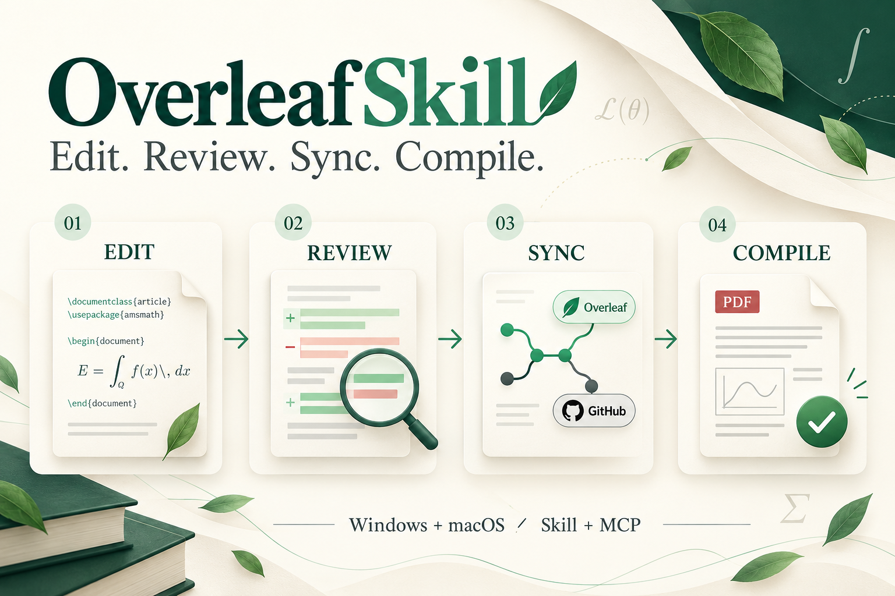
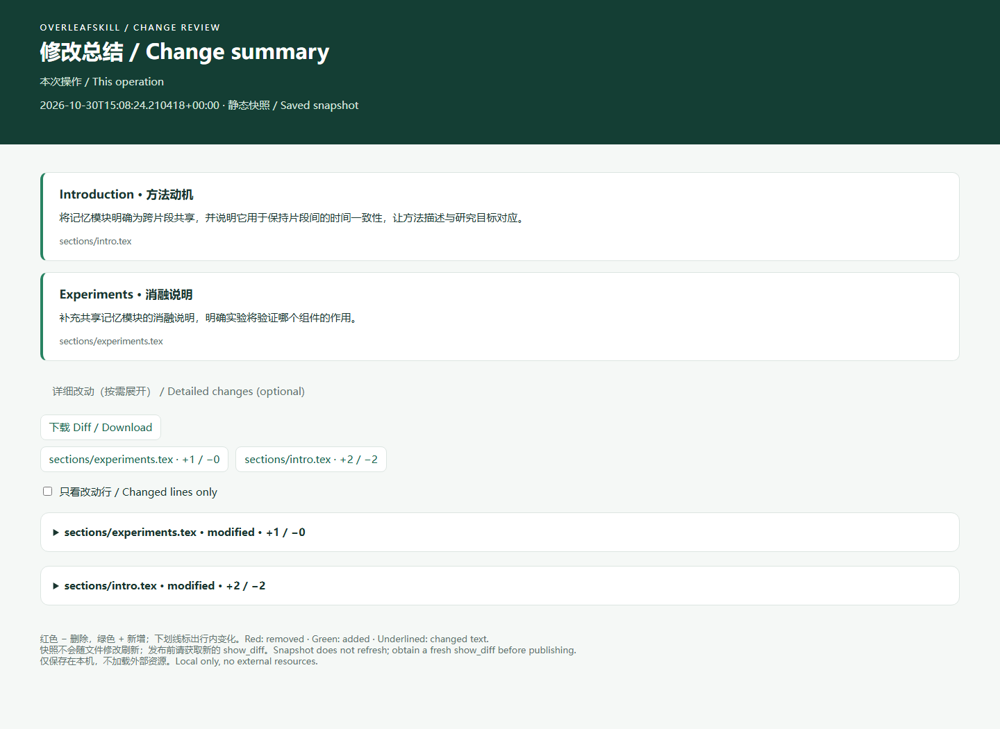
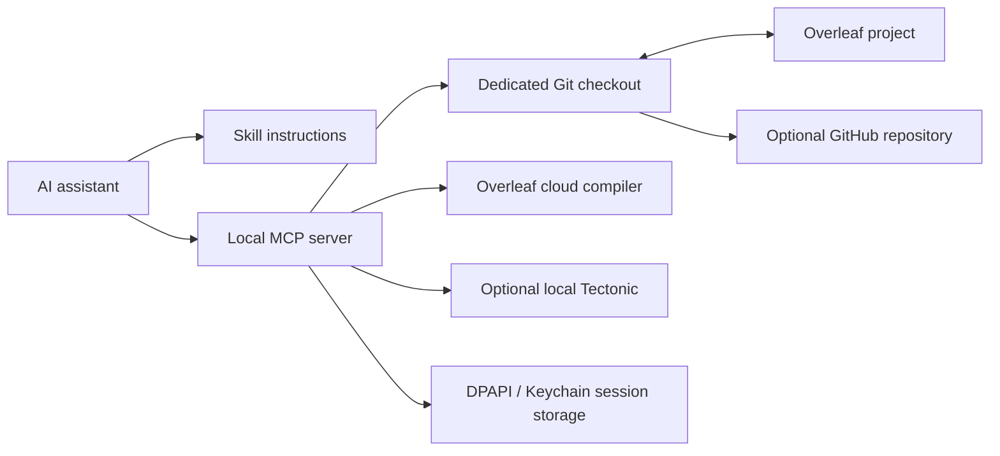

<div align="center">


# OverleafSkill

**Let your AI assistant edit, sync, and compile your Overleaf project.**

[简体中文](README.md) · **English**

[](https://github.com/yunyangge/OverleafSkill/actions/workflows/test.yml) [](LICENSE)

Windows · macOS · Python 3.10+ · Skill + MCP

</div>

<p align="center">
  
  <br><sub>Edit → Review → Sync → Compile · Windows and macOS</sub>
</p>

Update a paper, inspect the diff, publish to Overleaf, compile online, and sync the reviewed version to GitHub. OverleafSkill packages this workflow as an installable skill and a reproducible local MCP server. Use your existing assistant; no additional model API key is required.

## Contents

- [Quick start](#quick-start)
- [Example requests](#example-requests)
- [Capabilities and tools](#capabilities-and-tools)
- [Summaries that scale with the changes](#summaries-that-scale-with-the-changes)
- [How it works](#how-it-works)
- [Platforms and validation](#platforms-and-validation)
- [Repository guide](#repository-guide)
- [FAQ](#faq)
- [Development and contributions](#development-and-contributions)

## Quick start

### 1. Install the skill

Install Python 3.10+ and Git, then use your selected Python environment:

```sh
git clone https://github.com/yunyangge/OverleafSkill.git
cd OverleafSkill
python -m pip install -r requirements.txt
python install_skill.py
```

Use `python3` on macOS or `py -3.10` on Windows as appropriate. Conda users can use `conda run -n py310 python ...`. Windows core functionality uses the standard library; macOS website session storage adds a Keychain dependency.

The default destination is `$CODEX_HOME/skills/overleaf`, or `~/.codex/skills/overleaf` when unset. For an existing installation, use `python install_skill.py --upgrade`; the installer preserves a backup. Use `--dest` for another compatible agent's skill directory.

### 2. Connect a project

Once the assistant has loaded the skill, ask:

```text
Use $overleaf to connect my project and enable online compilation.
Project: https://www.overleaf.com/project/YOUR_PROJECT_ID
```

**Installing the skill does not authenticate accounts or register MCP.** Complete Git authentication, project configuration, and client registration next. Online compilation also requires a website session, obtained through optional isolated `browser-login` or imported locally through hidden input. Never send credentials in chat.

The [setup guide](skills/overleaf/references/setup.md) covers Windows/macOS, multiple projects, proxies, Codex registration and generic MCP configuration. Other clients can use the generated configuration with their required outer format.

### 3. Verify the connection

From the **installed skill directory**, replace `paper` with your configured profile:

```sh
python scripts/manage.py --profile paper doctor
python scripts/manage.py --profile paper auth-status
```

`doctor` checks local MCP and file access; `auth-status` checks the website session. To reproduce a fixed code version, run `git checkout v1.3.1` before installation.

## Example requests

| Task | Ask your assistant |
|---|---|
| Edit and review | “Revise the second Introduction paragraph, preserve citations, and show the diff without pushing.” |
| Publish and compile | “Publish the reviewed changes to Overleaf, compile online, and return the PDF and diagnostics.” |
| Keep a GitHub copy | “Sync the current committed version to my specified private GitHub repository.” |
| Set up another computer | “Use $overleaf to recreate the connection on this Mac with a dedicated checkout.” |
| Batch editing and undo | “Update these sections together and add a figure, keep a checkpoint, then show the diff.” |
| Diagnose problems | “Find missing citations and included files, compile asynchronously, and show error locations.” |

The assistant interprets the requested edits; the skill guides the workflow and MCP executes file, sync and compile operations.

## Capabilities and tools

| Capability | MCP tools | Behavior |
|---|---|---|
| Read a paper | `list_files`, `read_file` | Tracked files, UTF-8 text and SHA-256 |
| Precise edits | `patch_file` | Stale-version check and unique exact-text replacement; local only |
| Visual review | `show_diff` | Local side-by-side HTML, file statistics and content-bound review ID |
| Overleaf sync | `sync_project`, `publish_changes` | Pull or publish; refuse publication when the remote has new commits |
| GitHub sync | `sync_github` | Push committed HEAD without force |
| Local compile | `compile_project` | Optional Tectonic; log and PDF |
| Online compile | `online_auth_status`, `compile_overleaf` | Website session check and download of this build's log/PDF |
| Batch editing and undo | `batch_edit`, `undo_batch` | Prevalidation, failure rollback and checkpoints; create/replace/delete files |
| Binary assets | `file_info`, `batch_edit` | Hash files and write Base64 bytes; publish through reviewed Git changes |
| Push recovery | `retry_publish` | Retry committed HEAD; already-present is success, divergence is refused |
| Project overview | `project_status` | Local changes, remote ahead/behind, session and latest compile receipt |
| Search and references | `search_project`, `check_references` | Line-numbered literal search and missing citation/input/include heuristics |
| Async compile | `start_online_compile`, `compile_status` | Immediate job ID, polling and structured diagnostics |

**v1.3 exposes 19 MCP tools.** Editing tools store agent-authored change summaries, with line diffs available on demand. Cloud source is compared against committed Git blobs before and after compilation; mismatches stop the attempt or mark its result unsuccessful. MCP processes coordinate with a checkout lock. The installer supports backup upgrades and restore, and project metadata can be exported for re-authentication on another computer.

See the [tool contract](skills/overleaf/references/workflow.md) for parameters, recovery and result semantics.

## Summaries that scale with the changes

After each editing round, the assistant starts with a coherent paragraph explaining **the main changes, how they relate, and why they were made**. Larger revisions receive more detail across several paragraphs, grouped by theme or section when helpful. There is no fixed sentence count or mandatory entry for each edit. Describe effects on claims, values or citations when relevant; combine minor grammar/punctuation fixes.



- A complete paragraph by default, with more paragraphs for substantial or cross-section revisions, readable directly in chat.
- The assistant saves its summaries with the edit; no extra model service or scripted inference of intent.
- Line diffs stay collapsed until needed; expand comparisons or download before/after text.
- Separate snapshots survive subsequent edits and commits; `show_diff` explicitly labels its cumulative scope.
- Offline HTML opens in Windows/macOS browsers without a server or extra dependencies; paper content is not uploaded automatically.

Binary assets display sizes/hashes; large text files provide before/after downloads. Edits made through other tools need an explicit `show_diff` call. Pages are saved snapshots; publishing still uses a fresh review ID. [Example HTML source](assets/review-demo/index.html) · [Detailed behavior](skills/overleaf/references/workflow.md#visual-review-after-every-edit)

## How it works



Typical flow: **sync → read → edit → review diff → authorized publish → compile → optional GitHub sync**.

Keep `origin` for Overleaf and `github` for GitHub. This is a local two-remote workflow, not Overleaf's built-in GitHub OAuth integration. Git uses the local credential helper; website sessions use Windows DPAPI or native macOS Keychain.

## Platforms and validation

| Check | Windows | macOS |
|---|---|---|
| Python 3.10 / 3.12 CI | Passed | Passed |
| Git, MCP, simulated cloud compilation | Passed | Passed |
| Native session storage | DPAPI round-trip passed | Keychain backend loads; read/write routing tested with mocks |
| Live Overleaf compilation | v1.1 compile, PDF download and Git source comparison passed | Not yet tested |

[CI results](https://github.com/yunyangge/OverleafSkill/actions/workflows/test.yml) · [Detailed validation record](VALIDATION.md)

Online compilation uses internal website endpoints that may change. Git comparisons apply to before/after snapshots (known text line endings normalized); transient collaborator edits can still occur during compilation. Batch rollback handles ordinary failures, not crash-atomic multi-file transactions; checkout locks do not constrain external editors or website collaborators. Reference checks are static heuristics. Overleaf project creation, website review comments and automatic background two-way sync remain unsupported. Interactive browser login is mock-tested, without live-account verification on both platforms.

## Repository guide

```text
OverleafSkill/
├── README.md / README.en.md       Chinese and English home pages
├── assets/                       Logo, hero and generation notes
├── install_skill.py              Skill installer
├── requirements.txt              Platform dependencies
├── skills/overleaf/
│   ├── SKILL.md                  Agent entry point
│   ├── agents/openai.yaml        Skill display metadata
│   ├── scripts/                  MCP, setup and authentication
│   └── references/               Setup, workflows and architecture
├── tests/                        Git, protocol, auth and compile tests
├── .github/workflows/            Windows/macOS CI
└── VALIDATION.md                 Evidence and limitations
```

Start with [setup.md](skills/overleaf/references/setup.md) for configuration, [workflow.md](skills/overleaf/references/workflow.md) for operations, or [architecture.md](skills/overleaf/references/architecture.md) to extend the implementation. The installable skill is self-contained; the entire repository is not required at runtime.

## FAQ

**Do I need a paid Overleaf account?** Git integration must be available for the project. Institutional or project-owner entitlements may provide access.

**Why import a website session if Git already works?** Git handles source synchronization. Cloud compilation uses a separate website authentication mechanism.

**Do I need local LaTeX?** Not for online compilation. Only the local compile tool requires Tectonic.

**Will edits be pushed automatically?** Edits stay local. Publication and GitHub sync are separate operations performed within your authorization.

**Does pulling this repository update the installed skill?** No. Run `python install_skill.py --upgrade`; the printed backup directory can be restored with `--restore BACKUP_PATH`. Restart MCP after upgrading. If its registration points at another code directory, update that path. Project configurations and credentials live outside the skill directory.

**How do I migrate to another computer?** Use `export-profile`, then `import-profile` with a new local checkout path on the destination. Authenticate Git/the website and register MCP there. Credentials are not exported; configure the optional GitHub remote and compiler on the destination. See [upgrade and migration](skills/overleaf/references/setup.md#upgrade-rollback-and-migration).

## Development and contributions

```sh
python -m unittest discover -s tests -p "test_*.py" -v
```

Tests use temporary repositories and simulated cloud responses, without real accounts. Include your OS, Python version, reproduction steps and sanitized errors in reports; do not upload cookies, tokens or private papers. Keep capabilities and validation statements aligned across both README languages.

The homepage reading order and bilingual navigation were inspired by [CCFA-Skills](https://github.com/mikubaka88/CCFA-Skills); the content describes OverleafSkill's own implementation.

MIT license. Independent community project, not affiliated with Overleaf, GitHub or OpenAI.
