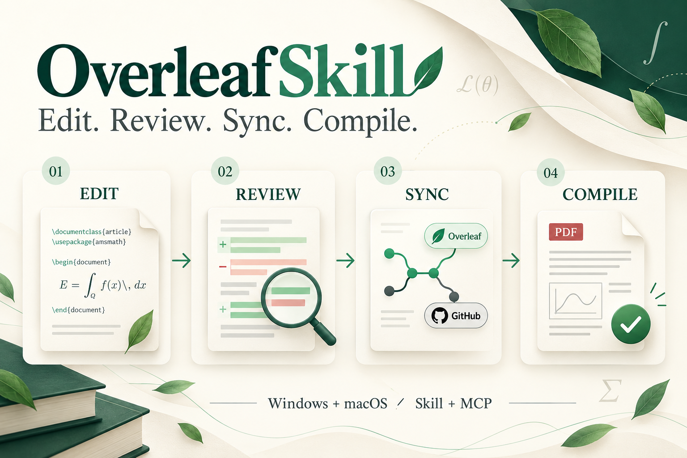
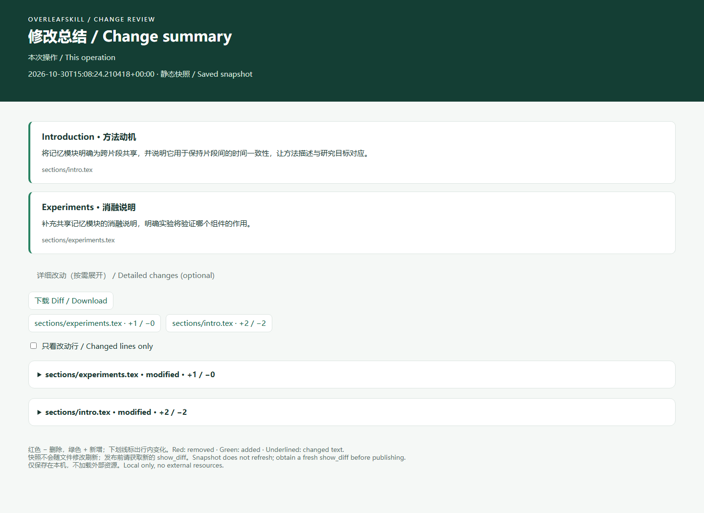
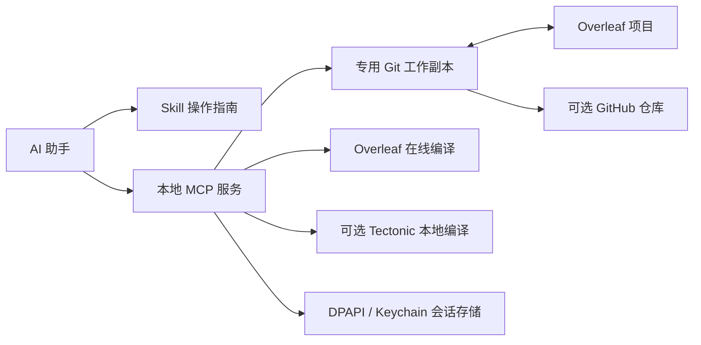

<div align="center">


# OverleafSkill

**让 AI 在你的 Overleaf 项目中完成修改、同步与编译。**

**简体中文** · [English](README.en.md)

[](https://github.com/yunyangge/OverleafSkill/actions/workflows/test.yml) [](LICENSE)

Windows · macOS · Python 3.10+ · Skill + MCP

</div>

<p align="center">
  
  <br><sub>编辑 → 审阅 → 同步 → 编译 · 支持 Windows 与 macOS</sub>
</p>

实验结果更新后，你可以让助手修改论文中的相应段落，先查看差异，再同步到 Overleaf、在线编译，并将确认后的版本推送到 GitHub。OverleafSkill 把这套流程整理成可安装的 skill 和可复现的本地 MCP 服务，使用你已有的 AI 助手，无需额外的模型 API Key。

## 目录

- [快速开始](#快速开始)
- [你可以这样使用](#你可以这样使用)
- [功能与工具](#功能与工具)
- [按改动规模提供完整总结](#按改动规模提供完整总结)
- [工作原理](#工作原理)
- [平台与验证](#平台与验证)
- [仓库导航](#仓库导航)
- [常见问题](#常见问题)
- [开发与贡献](#开发与贡献)

## 快速开始

### 1. 安装 skill

准备 Python 3.10+ 和 Git，在选定的 Python 环境中运行：

```sh
git clone https://github.com/yunyangge/OverleafSkill.git
cd OverleafSkill
python -m pip install -r requirements.txt
python install_skill.py
```

macOS 可将 `python` 换为 `python3`，Windows 可使用 `py -3.10`。Conda 用户可使用 `conda run -n py310 python ...`。Windows 核心功能只依赖标准库；macOS 的在线会话存储额外使用 Keychain 依赖。

默认安装到 `$CODEX_HOME/skills/overleaf`，未设置时为 `~/.codex/skills/overleaf`。已有版本使用 `python install_skill.py --upgrade`，安装器会保留旧版本备份；其他兼容 Agent 可用 `--dest` 指定其技能目录。

### 2. 连接你的项目

在助手加载 skill 后，输入：

```text
使用 $overleaf 连接我的 Overleaf 项目，配置在线编译。
项目地址：https://www.overleaf.com/project/你的项目ID
```

**安装 skill 不等于连接账号或注册 MCP。** 后续需要完成 Git 认证、项目配置和客户端注册；在线编译还需单独网页登录，可用可选的 `browser-login` 打开独立浏览器，或通过隐藏输入导入会话。凭据只在本机输入，不要发送到聊天中。

[完整配置指南（英文）](skills/overleaf/references/setup.md)覆盖 Windows/macOS、多个项目、代理、Codex 注册和通用 MCP 配置。其他 MCP 客户端可以使用生成的配置，但仍需按客户端要求调整外层格式。

### 3. 验证连接

在**已安装的 skill 目录**中运行以下命令，`paper` 替换为配置时的 profile 名称：

```sh
python scripts/manage.py --profile paper doctor
python scripts/manage.py --profile paper auth-status
```

`doctor` 检查本地 MCP 和文件访问；`auth-status` 检查网页登录。要复现固定代码版本，可在安装前执行 `git checkout v1.3.1`。

## 你可以这样使用

| 想做的事情 | 可以对助手说 |
|---|---|
| 先修改、后检查 | “修改 Introduction 的第二段，保留引用，先展示差异，不推送。” |
| 发布并编译 | “把确认过的修改同步到 Overleaf，在线编译并返回 PDF 和错误日志。” |
| 保存 GitHub 副本 | “将当前已提交版本同步到我指定的 GitHub 私有仓库。” |
| 换一台电脑 | “用 $overleaf 在这台 Mac 上重建连接，使用独立工作副本。” |
| 批量修改与撤销 | “一起修改这几个章节并添加新图片，保留检查点，先展示差异。” |
| 定位问题 | “检查缺失引用和子文件，异步在线编译，告诉我错误位置。” |

助手仍负责理解你的修改意图；skill 规定操作流程，MCP 执行文件、同步和编译操作。

## 功能与工具

| 能力 | MCP 工具 | 行为 |
|---|---|---|
| 读取论文 | `list_files`、`read_file` | 列出已跟踪文件，读取文本及 SHA-256 |
| 精确修改 | `patch_file` | 校验旧版本，替换唯一原文片段，修改保留在本地 |
| 可视化审阅 | `show_diff` | 返回左右对照的本地 HTML、文件统计和与当前内容绑定的 review ID |
| Overleaf 同步 | `sync_project`、`publish_changes` | 拉取或发布；远端有新提交时停止发布 |
| GitHub 同步 | `sync_github` | 推送已提交版本，不强制覆盖远端 |
| 本地编译 | `compile_project` | 使用可选的 Tectonic，返回日志和 PDF |
| 在线编译 | `online_auth_status`、`compile_overleaf` | 检查会话，使用 Overleaf 编译并下载本次构建的产物 |
| 批量修改与撤销 | `batch_edit`、`undo_batch` | 预检查、失败回滚、检查点撤销；支持新增、替换和删除文件 |
| 图片等二进制资源 | `file_info`、`batch_edit` | 获取文件哈希、Base64 写入，通过 Git 审阅后发布 |
| 推送恢复 | `retry_publish` | 重试已提交版本；远端已存在时直接成功，分叉时停止 |
| 项目概览 | `project_status` | 本地修改、远端领先/落后、会话状态、最近编译记录 |
| 搜索与引用检查 | `search_project`、`check_references` | 带行号搜索、缺失引用键和 input/include 文件检查 |
| 异步编译 | `start_online_compile`、`compile_status` | 立即返回任务 ID，可轮询结果与结构化诊断 |

**v1.3 共 19 个 MCP 工具。** 编辑工具支持保存 AI 撰写的修改总结，逐行差异按需展开。在线编译前后都会将云端源文件与 Git 提交比对；不一致时停止或将本次结果标为失败。各 MCP 进程使用同一项目锁，减少并发操作冲突。安装器支持备份升级与回退，项目元数据可导出后在另一台电脑重新认证连接。

输入参数、错误恢复和编译结果含义见[工具契约（英文）](skills/overleaf/references/workflow.md)。

## 按改动规模提供完整总结

每轮修改后，助手默认用一段连贯的话总结**主要改了什么、各项改动如何关联、为什么这样改**。内容较多时按主题或章节扩展成多段，信息量随改动规模增加，不限制句数，也不强制为每个改动单列一条。论点、数据或引用受到影响时说明具体变化；语法、标点等零碎修正合并概括。



- 默认一段完整总结，大幅或跨章节修改可用多段展开，聊天回复中即可理解。
- AI 将总结随修改存入审阅记录；不调用额外模型服务，也不由脚本猜测修改意图。
- 逐行 Diff 默认折叠，需要时可展开左右对照或下载前后文本。
- 每次操作独立留档，后续修改与提交不会覆盖旧快照；`show_diff` 明确标示全部未提交修改的范围。
- 本地 HTML，Windows/macOS 浏览器直接打开，不需要服务或额外依赖；不会自动上传论文内容。

图片等二进制资源展示大小与哈希；较大文本提供前后文件下载。通过其他编辑工具修改后，需要调用 `show_diff` 生成审阅页。页面是静态快照，发布仍使用新获取的 review ID。[示例页面源码](assets/review-demo/index.html) · [详细行为](skills/overleaf/references/workflow.md#visual-review-after-every-edit)

## 工作原理



推荐流程：**同步 → 读取 → 修改 → 查看差异 → 按授权发布 → 编译 → 可选 GitHub 同步**。

`origin` 保留给 Overleaf，`github` 用于 GitHub。这是本地双远端工作流，不是 Overleaf 网页中的 GitHub OAuth 关联。Git 凭据由本机 Git 凭据管理器管理；网页登录会话在 Windows 上使用 DPAPI，在 macOS 上使用原生 Keychain。

## 平台与验证

| 验证项 | Windows | macOS |
|---|---|---|
| Python 3.10 / 3.12 自动测试 | 已通过 | 已通过 |
| Git、MCP、模拟在线编译 | 已通过 | 已通过 |
| 原生会话存储 | DPAPI 往返验证通过 | Keychain 后端加载通过，读写路径有模拟测试 |
| 真实 Overleaf 账号在线编译 | v1.1 编译、PDF 下载及 Git 源码比对通过 | 尚未实测 |

[查看 CI](https://github.com/yunyangge/OverleafSkill/actions/workflows/test.yml) · [详细验证记录（英文）](VALIDATION.md)

在线编译依赖 Overleaf 内部网页接口，未来可能需要适配。Git 比对针对编译前后的快照（已知文本类型统一换行符），不能排除编译期间发生后又恢复的协作编辑。批量修改支持普通异常回滚，但不保证断电时多个文件原子更新；项目锁也不约束外部编辑器或网页协作者。引用检查是静态启发式。当前不支持创建 Overleaf 项目、网页审阅批注或自动后台双向同步。浏览器交互登录已做模拟测试，尚未完成双平台真实账号验证。

## 仓库导航

```text
OverleafSkill/
├── README.md / README.en.md       中英文项目首页
├── assets/                       Logo、首页展示图及生成说明
├── install_skill.py              skill 安装器
├── requirements.txt              平台依赖
├── skills/overleaf/
│   ├── SKILL.md                  Agent 操作入口
│   ├── agents/openai.yaml        技能展示信息
│   ├── scripts/                  MCP、配置和认证实现
│   └── references/               配置、工作流、架构文档
├── tests/                        Git、协议、认证与编译测试
├── .github/workflows/            Windows/macOS CI
└── VALIDATION.md                 验证范围和已知边界
```

配置项目请看 [setup.md](skills/overleaf/references/setup.md)，日常操作请看 [workflow.md](skills/overleaf/references/workflow.md)，修改实现请看 [architecture.md](skills/overleaf/references/architecture.md)。可执行 skill 保持自包含，安装时不需要复制整份仓库。

## 常见问题

**需要 Overleaf 付费吗？** 项目必须具备 Git integration 权限，学校订阅或项目所有者的权益也可能提供该权限。

**已有 Git Token，为什么还要网页登录？** Git 接口负责源文件同步；在线编译走网页登录会话，两者不是同一种凭据。

**必须安装 LaTeX 吗？** 使用在线编译无需本地 TeX；只有本地编译功能需要 Tectonic。

**会自动推送吗？** 修改默认留在本地，发布和 GitHub 同步是独立操作，按你的授权执行。

**更新源码后，已安装 skill 会自动更新吗？** 不会。运行 `python install_skill.py --upgrade`，旧版本会保存到输出中的备份目录；用 `--restore 备份目录` 回退。升级后重启 MCP；若注册仍指向其他代码目录，需更新注册路径。项目配置和凭据保存在 skill 目录之外。

**如何迁移到另一台电脑？** 使用 `export-profile` 导出项目标识，在目标电脑用 `import-profile` 指定新的本地目录，再完成 Git/网页登录与 MCP 注册。凭据不会导出，GitHub 远端和本地编译器按新机器重新配置。详见[升级与迁移](skills/overleaf/references/setup.md#upgrade-rollback-and-migration)。

## 开发与贡献

```sh
python -m unittest discover -s tests -p "test_*.py" -v
```

测试使用临时 Git 仓库和模拟云端响应，不需要真实账号。提交问题时请提供系统、Python 版本、复现步骤和脱敏错误；不要上传 Cookie、Token 或私有论文。修改 README 时请同步维护两种语言的能力与验证描述。

本仓库首页的阅读顺序与双语入口借鉴了 [CCFA-Skills](https://github.com/mikubaka88/CCFA-Skills)，内容按 OverleafSkill 的实际能力重新编写。

MIT 许可证。独立社区项目，与 Overleaf、GitHub、OpenAI 无隶属关系。
